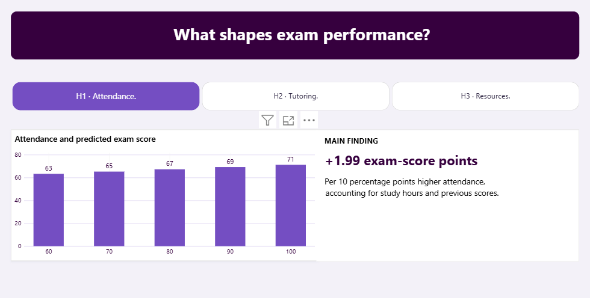
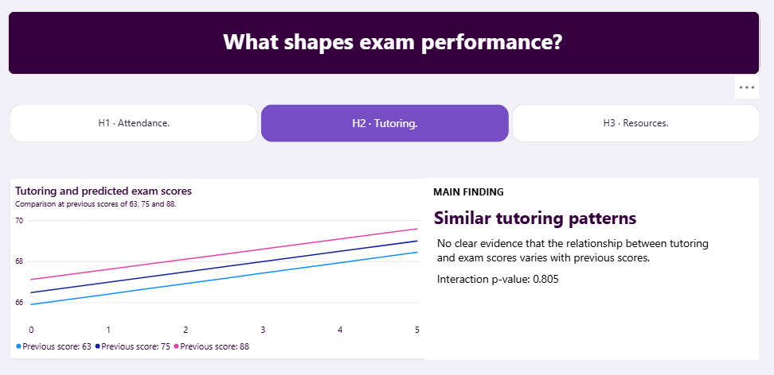
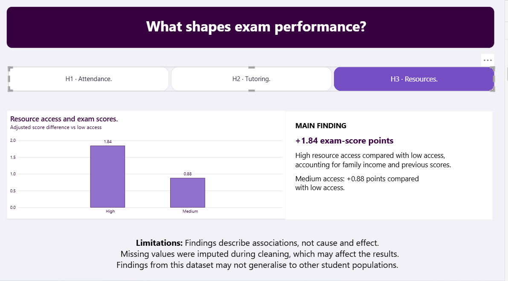
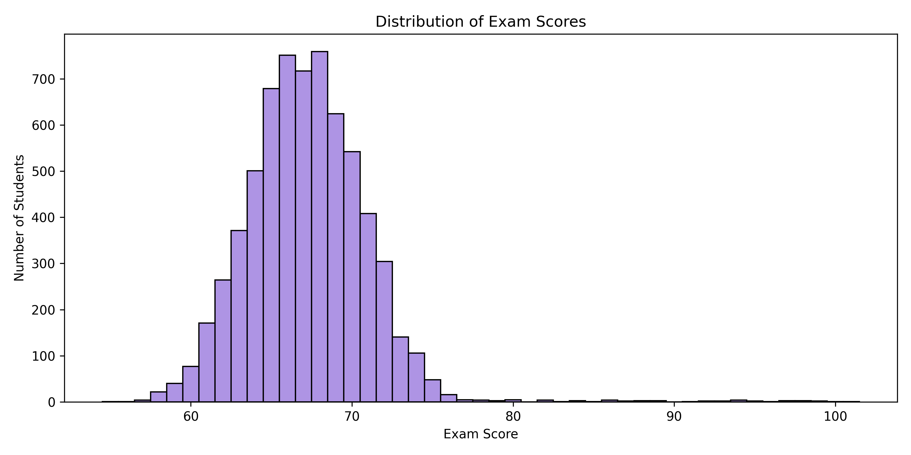
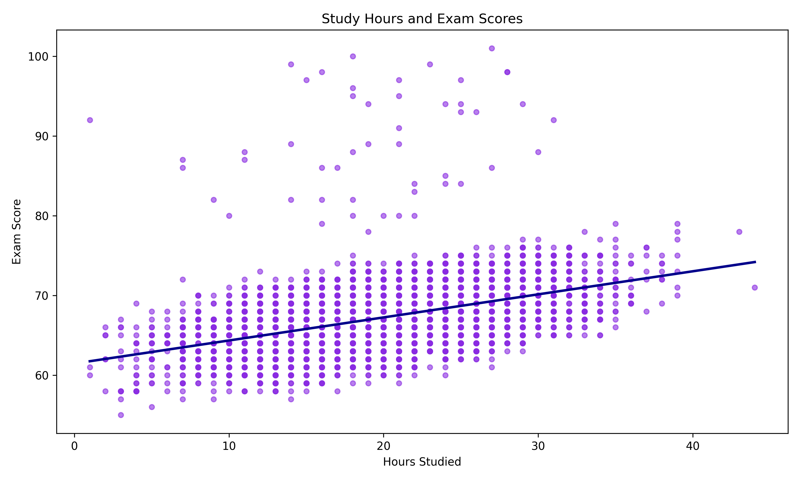
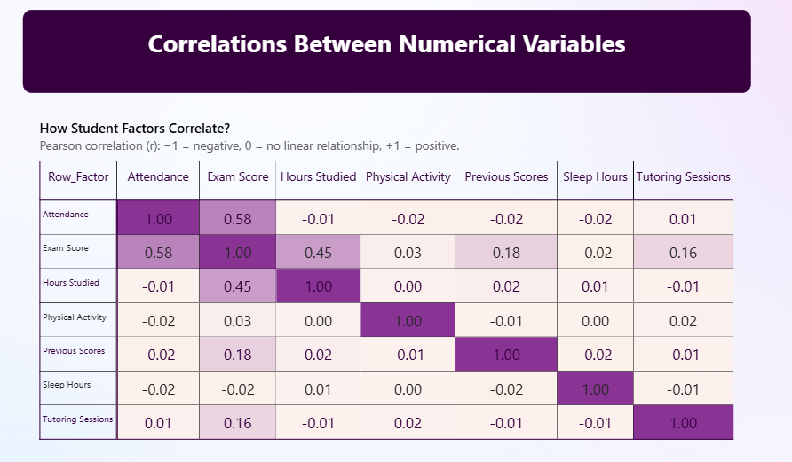
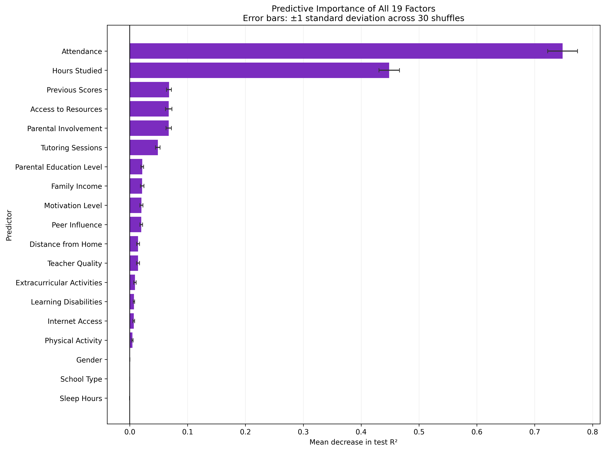
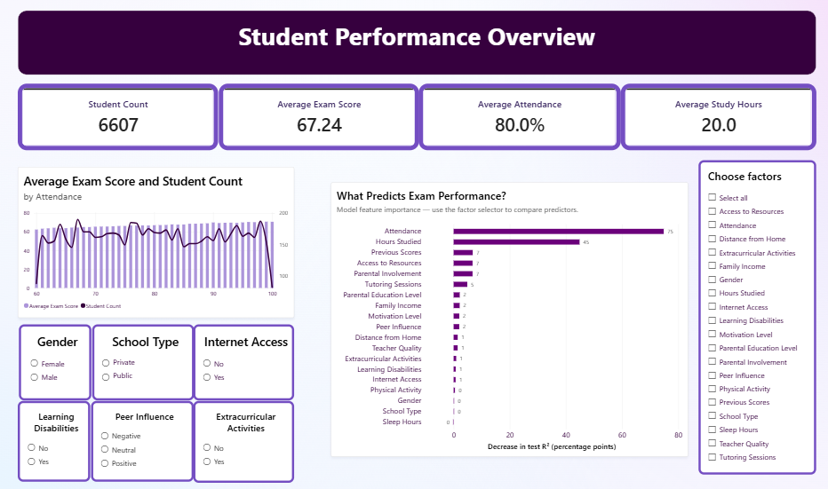
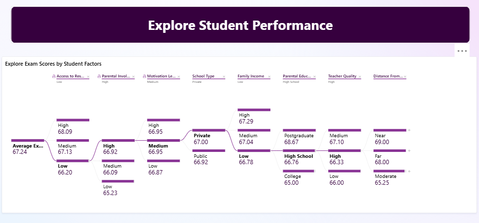

# Student Performance Analysis

## Project Overview

Imagine a school leadership team asking:
**“What is associated with stronger exam results, and where
should we focus further investigation to better support students?”**

Attendance, study habits, tutoring and access to learning
resources are all possible starting points. However, examining
one factor alone may overlook differences in students’ previous
performance or circumstances.

Using a dataset of 6,607 student records, this project explores
those questions through descriptive analysis, statistical testing
and predictive modelling. It follows a journey from identifying
patterns to examining selected relationships more closely,
then presenting the findings in an interactive dashboard.

The aim is to give education stakeholders a clearer starting
point for evidence-informed discussion, while recognising that
these findings describe associations rather than proving which
interventions would improve results.

## 
Student Performance Analysis explores how study habits,
attendance, educational support and student characteristics
are associated with exam performance.

The project combines data cleaning, exploratory analysis,
statistical hypothesis testing, linear regression modelling
and a four-page interactive Power BI dashboard.

Its purpose is to communicate evidence clearly while
distinguishing descriptive patterns, adjusted statistical
relationships and model predictions.

This project was developed as part of the Code Institute
Data Analytics bootcamp.

## Dataset Content

The project uses the **Student Performance Factors** dataset,
published on Kaggle by `lainguyn123`.

[View the original dataset](https://www.kaggle.com/datasets/lainguyn123/student-performance-factors)

The dataset contains **6,607 records and 20 original columns**:

- Seven numerical variables covering study hours, attendance,
  sleep, previous scores, tutoring, physical activity and
  final exam scores.
- Thirteen categorical variables describing educational
  resources, family background and student characteristics.

The outcome variable is `Exam_Score`.

### Data Files

- Original data: `data/raw/StudentPerformanceFactors.csv`
- Cleaned data: `data/processed/StudentPerformanceFactors_cleaned.csv`
- Correlation export: `data/processed/numerical_correlations.csv`

The publisher's description explains the variables but does
not establish the original collection or generation process,
sampling method, location or collection dates.

The project therefore does not assume that the dataset
represents a particular real-world student population.

Detailed definitions, units, categories and limitations are
provided in the [data dictionary](data_dictionary.md).

## Business Requirements

The project addresses the following analytical requirements:

1. Provide an accessible overview of student performance.
2. Explore relationships between exam scores, attendance
   and study habits.
3. Test specific questions about attendance, tutoring and
   educational resources.
4. Build a regression model to predict numerical exam scores
   and examine its reliance on different predictors.
5. Allow users to explore average scores across combinations
   of student characteristics.
6. Communicate findings through an interactive dashboard
   with clear explanations and appropriate limitations.

The intended audience includes educators, education
stakeholders and non-technical readers.

### Questions from an Education Stakeholder

The analysis is guided by questions a school leadership
team might ask:

- **What stands out about exam performance across the dataset?**
- **Is higher attendance associated with better exam results
  when study hours and previous scores are considered?**
- **Does the relationship between tutoring and exam scores
  differ for students with different previous scores?**
- **Are differences in access to learning resources associated
  with exam scores after accounting for family income and
  previous performance?**
- **How accurately can we predict exam scores, and which
  factors does the model rely on most?**
- **What do the findings suggest we should investigate next
  to better understand students’ support needs?**

The analysis supports exploration and discussion. It is
not a validated system for making decisions about individual
students.

## Hypotheses and Validation

### H1 — Attendance and Exam Performance

**Hypothesis:** Higher attendance is associated with higher
exam scores after accounting for study hours and previous scores.

**Method:** Ordinary least squares regression with
heteroskedasticity-robust HC3 standard errors.

The model includes Attendance, Hours Studied and Previous Scores.

**Finding:** Ten percentage points higher attendance are
associated with approximately **1.99 additional exam-score
points**, accounting for the other variables in the model.

### H2 — Tutoring and Previous Scores

**Hypothesis:** The association between tutoring sessions and
exam scores varies according to previous scores.

**Method:** Regression including tutoring, previous scores
and their interaction. The numerical predictors are centred
for interpretation.

**Finding:** The interaction p-value is approximately **0.805**.
The analysis does not provide clear evidence that the tutoring
association varies with previous scores.

The dashboard compares predicted scores at previous-score
levels of **63, 75 and 88**.

### H3 — Access to Resources

**Hypothesis:** Exam scores differ across resource-access
groups after accounting for family income and previous scores.

**Method:** Regression treating resource access as a
categorical predictor, with Low access as the reference group.

**Finding:**

- High access is associated with approximately **1.84 higher
  exam-score points** than Low access.
- Medium access is associated with approximately **0.88 higher
  exam-score points** than Low access.

These estimates account for family income and previous scores.

### Interpretation

These results describe associations. Statistical adjustment
does not establish that changing a factor will cause the
estimated change in exam score.

Full model outputs, diagnostics and interpretation are
provided in the hypothesis-testing notebook.

## Project Plan

The project follows a staged workflow:

1. Define analytical questions and project requirements.
2. Obtain and inspect the dataset.
3. Check data quality and prepare a cleaned dataset.
4. Explore distributions and relationships.
5. Test the three hypotheses.
6. Develop and evaluate a linear regression prediction model.
7. Export analytical results for Power BI.
8. Build and test the dashboard.
9. Document findings, limitations and learning.
10. Prepare the presentation and final submission.

Tasks are managed using a GitHub project board with
**To Do**, **In Progress** and **Done** columns.

Git commits record changes to notebooks, exported results,
dashboard files and documentation.

### Data Management

The original CSV is kept separately from the processed data.
Cleaning and transformation decisions are documented in the
notebooks.

Exploratory analysis, hypothesis testing and machine learning
are organised into separate notebooks to keep their purposes
and outputs clear.

Python-generated results are exported for use in Power BI.
When an analysis changes, its exports and the dashboard must
be refreshed together.

### Methodology Rationale

Exploratory analysis establishes the structure and quality of
the data before formal modelling.

Regression is used for the hypotheses because it allows
specified variables to be considered together and produces
interpretable estimates.

Linear regression is used for prediction because Exam Score
is numerical and an interpretable baseline model is appropriate
for the project's scope.

Power BI provides interactive exploration and a presentation
layer for readers who do not use Python.

## Mapping Requirements to Visualisations

| Requirement | Visualisation or report element | Rationale |
| --- | --- | --- |
| Summarise the dataset | Four Overview cards | Provide immediate context about student count and average measures. |
| Explore attendance | Average exam score and student count combination chart | Show score patterns alongside the number of records at each attendance level. |
| Compare model predictors | Ranked horizontal importance bars | Make relative predictor importance easier to compare. |
| Present attendance findings | Predicted-score column chart and finding panel | Connect the adjusted relationship with a concise numerical explanation. |
| Examine tutoring interaction | Three predicted-score lines | Compare tutoring patterns at different previous-score levels. |
| Compare resource access | Adjusted-difference columns | Show High and Medium access relative to Low access. |
| Explore student groups | Decomposition tree | Allow users to follow combinations of student characteristics. |
| Compare numerical relationships | Correlation heatmap | Display the direction and strength of pairwise linear associations. |

## Analysis Techniques Used

### Data Inspection and Cleaning

The preparation stage checks dataset structure, data types,
missing values, duplicate records, categories and unusual values.

The notebooks document the cleaning decisions used to produce
the processed dataset.

### Exploratory Data Analysis

Descriptive statistics and visualisations examine distributions,
variation and relationships between variables.

#### Understanding the starting point

Before exploring why exam scores differ, we first need to
understand how those scores are distributed. An overall average
provides a useful summary, but it does not show how closely
students cluster around it or how common unusually high and
low scores are.

This chart provides context for the analysis that follows:
how do study habits, attendance and educational support relate
to the variation in exam performance?

#### Are more study hours associated with higher scores?

A school leadership team might ask whether students who spend
more time studying also tend to achieve higher exam scores.

Study hours and exam scores have a positive correlation of
approximately **0.45** in this dataset. Students who study more
tend to score higher, but study time alone does not fully explain
differences in performance.

This leads to a broader question: how do attendance, previous
attainment and access to support relate to exam results
alongside study time?

Pearson correlations summarise pairwise linear relationships.
Attendance and Hours Studied have correlations with Exam Score
of approximately **0.58** and **0.45**, respectively.

These correlations do not account for other variables and
should not be interpreted as adjusted effects.

#### Where do the strongest patterns appear?

For a school leadership team, an initial question is whether
exam performance is more closely linked to classroom attendance,
independent study or other recorded habits.

Attendance and study hours show the strongest positive
correlations with exam scores among the numerical variables,
at approximately **0.58** and **0.45**, respectively.

This gives the investigation a starting point: students with
higher attendance or more study hours tend to achieve higher
scores in this dataset. However, these patterns alone cannot
tell us whether attendance matters independently of study time
and previous attainment.

The H1 analysis addresses that next question by considering
all three factors together. Its findings show that the positive
attendance relationship remains after accounting for study
hours and previous scores.

### Hypothesis Testing

The statistical analysis uses regression models, robust standard
errors, confidence intervals and hypothesis tests.

Diagnostic and sensitivity work examines issues such as
residual patterns, multicollinearity and influential observations.

These checks support interpretation but do not remove the
dataset's provenance and measurement limitations.

### Machine Learning

A linear regression model predicts Exam Score from the
available predictors.

Permutation importance evaluates how much the fitted model's
test R² decreases when an original predictor is shuffled.

The calculation uses 30 repeats. Mean importance is multiplied
by 100 for the dashboard and labelled:

**Decrease in test R² (percentage points)**

Importance values do not represent causal effects, changes
in student marks or percentages that must total 100.

#### How well does the model predict exam scores?

To assess whether the model adds predictive value, linear regression was compared with a baseline that predicts the training-set mean exam score for every test student.

| Model | MAE | RMSE | R² |
|---|---:|---:|---:|
| Mean baseline | 2.823 | 3.761 | -0.001 |
| Linear regression | 0.450 | 1.803 | 0.770 |

On the held-out test set, linear regression reduced the average absolute prediction error from approximately 2.82 to 0.45 exam-score points. Its R² of 0.770 indicates that it explained approximately 77% of the variation in test-set exam scores.

The higher RMSE compared with MAE indicates that some predictions had substantially larger errors. This means the average error alone does not tell the whole story.

These results demonstrate predictive value within this dataset and test split. They do not establish performance in other student populations or show that changing a predictor would cause exam scores to improve.

#### Which factors does the prediction model rely on?

After examining individual relationships, the next question
is how the available factors contribute to predicting exam
scores together.

Permutation importance measures how much predictive performance
drops when a predictor's values are shuffled. A larger decrease
indicates that the fitted model relies more heavily on that
factor for its predictions.

For education stakeholders, this provides another way to
identify factors worth investigating. It does not establish
which intervention would improve results: being useful for
prediction is different from demonstrating a causal effect.

Model evaluation outputs are recorded in
`jupyter_notebooks/Student_Performance_Machine_Learning.ipynb`.

### Limitations and Alternative Approaches

Linear models may not capture complex non-linear patterns.
Pearson correlation also focuses on linear relationships.

More flexible models could be compared in future, but would
require appropriate validation and attention to interpretability.

Uncertain provenance limits external validity. More complex
modelling cannot compensate for an unverified sampling or
generation process.

### Use of Generative AI

ChatGPT assisted with:

- Discussing analytical approaches and project structure.
- Drafting and explaining code.
- Troubleshooting errors.
- Developing dashboard layouts, labels and explanations.
- Drafting documentation.

AI-assisted material was adapted during development.
Code comments acknowledge assistance where included, and
documentation references identify the relevant tools and methods.

AI assistance does not replace checking code outputs, source
definitions or statistical interpretation.

## Ethical Considerations

The dataset includes potentially sensitive characteristics
such as gender, family income and learning disabilities.

These fields must not be used to stereotype students or justify
discriminatory treatment. The categories also simplify student
experiences and do not represent every identity or support need.

The original columns contain no names or direct identifiers.
However, this does not establish that re-identification would
be impossible in every context.

The project does not attempt to identify individuals.

Results are intended for educational analysis. They should not
be used alone to determine admissions, grades, disciplinary
actions or access to support.

Further discussion is provided in the
[data dictionary](data_dictionary.md).

## Dashboard Design

The dashboard contains four pages with a consistent purple
theme, pale backgrounds and white visual containers.

### 1. Overview

## Student Performance Overview

Four cards display the unfiltered reference values:

| Measure | Value |
| --- | --- |
| Student Count | 6,607 |
| Average Exam Score | 67.24 |
| Average Attendance | 80.0% |
| Average Study Hours | 20.0 |

The overview gives the school leadership team a starting point:
what does performance look like across these 6,607 student records,
and which patterns deserve a closer look?

The summary cards establish the overall picture. The attendance
chart then compares average exam scores alongside student counts,
helping readers see both the pattern and how many records
contribute to it.

The model-importance chart provides a different perspective:
which factors does the prediction model rely on most?
Together, these visuals guide the reader from a broad overview
towards more focused questions about attendance, learning
resources and student support.

The page also contains:

- A combination chart of average exam score and student count
  by attendance.
- A ranked model feature-importance chart.
- A **Choose factors** checkbox slicer.
- Student slicers for Gender, School Type, Internet Access,
  Learning Disabilities, Peer Influence and Extracurricular
  Activities.

The student slicers support student-level exploration.
The factor selector controls which importance bars are shown.

### 2. Hypothesis Findings

## What shapes exam performance?

Three bookmark buttons switch between:

- H1 · Attendance.
- H2 · Tutoring.
- H3 · Resources.

Each view displays its chart on the left and a
**MAIN FINDING** panel on the right. The selected button
is highlighted in purple.

This arrangement presents one statistical finding at a time
without requiring three separate report pages.

### 3. Explore Performance

## Explore Student Performance

A wide decomposition tree displays **Average Exam Score**.

Users can expand branches to explore combinations of student
characteristics. Each further split applies within the
previously selected subgroup.

The small study-hours line chart was removed during development
to give the tree sufficient space and keep the page focused.

The overall average provides a starting point, but it can hide differences between groups. The decomposition tree lets readers explore average exam scores across combinations of student characteristics. Each branch narrows the selected group, helping readers develop questions for further investigation. These comparisons are descriptive and do not establish why groups differ.

### 4. Correlations

## Correlations Between Numerical Variables

A seven-by-seven matrix displays Pearson correlations for:

- Attendance
- Exam Score
- Hours Studied
- Physical Activity
- Previous Scores
- Sleep Hours
- Tutoring Sessions

Values display to two decimal places. Conditional background
colours use a scale centred on zero, with purple representing
positive relationships and orange representing negative ones.

The diagonal shows 1.00. Totals are disabled because adding
correlation coefficients is not a meaningful summary.

### Communicating to Different Audiences

Summary cards, readable titles and main-finding panels provide
an accessible starting point for non-technical readers.

Technical readers can consult the notebooks for modelling
decisions, diagnostics and statistical outputs.

The dashboard distinguishes descriptive averages, adjusted
findings, correlations and model importance through titles,
units and explanatory text.

### Interaction Boundaries

Imported hypothesis results, model importance and correlations
are fixed Python outputs.

Student slicers do not retrain the model or rerun statistical
analyses. Updated results require rerunning the relevant
notebook exports and refreshing Power BI.

The detailed page design is documented in
[Dashboard Planning and Design](powerbi/dashboard_plan.md).

## Testing and Validation

Manual dashboard interaction checks were completed during
development, including:

- Student slicer filtering.
- Selecting multiple factors in the importance chart.
- Switching between H1, H2 and H3 bookmark views.
- Exploring decomposition-tree branches.

The developer confirmed that the dashboard interactions worked.

Displayed hypothesis statements were compared with the visible
chart values, including H1 +1.99, H2 p = 0.805 and H3 +1.84
and +0.88.

### Remaining Submission Checks

- Run the notebooks in their intended order and check for errors.
- Confirm that exported results match the final analysis.
- Verify file paths and setup instructions.
- Check README links and add final dashboard screenshots.
- Review assessment coverage.
- Confirm the final repository state before submission.

These checks remain pending until recorded as completed.

## Unfixed Bugs and Known Limitations

No unresolved dashboard interaction bug was reported after
the manual checks. This does not constitute a completed
end-to-end test of the whole project.

Known presentation and portability limitations include:

- Some decomposition-tree headings are shortened when many
  branches are expanded.
- Rounded importance labels may display very small values as
  zero, although the underlying values can be non-zero.
- Power BI data-source paths may need updating on another
  computer.
- Precomputed statistical exports do not recalculate for
  student-level filters.

These limitations should be considered when interpreting or
opening the report.

## Development Roadmap and Learning Reflection

### Challenges and Responses

The dashboard layout changed during development as visual
readability and available space were assessed.

Several chart ideas were explored before selecting a ranked
bar chart for model importance. A factor selector supports
comparison without requiring every predictor to be displayed
at once.

The study-hours line chart was removed from the final report
because it did not fit the purpose and layout of the
decomposition-tree page.

Decimal importance values were difficult to interpret visually.
They were rescaled to percentage points, with an explicit
axis label explaining that they represent decreases in test R².

The correlation matrix was exported from Python in a long
format so that Power BI could use separate row-factor,
column-factor and correlation fields.

### Learning

The project developed practical experience in:

- Organising a reproducible analysis across notebooks.
- Interpreting adjusted regression results and interactions.
- Distinguishing association from causation.
- Explaining model importance accurately.
- Building Power BI slicers, bookmark navigation,
  decomposition trees and conditional formatting.
- Using Git and a project board to track development.

### Future Improvements

Potential improvements include:

- Displaying subgroup counts alongside tree averages.
- Improving readability when many tree branches are expanded.
- Comparing additional regression models with suitable validation.
- Assessing predictive performance across student groups.
- Validating findings against a dataset with documented provenance.
- Developing an optional Streamlit application for additional
  interactive analysis.

## Running the Project

### Python Analysis

Clone the repository and open it in VS Code.

Create and activate a virtual environment in PowerShell:

    python -m venv .venv
    .\.venv\Scripts\Activate.ps1

Install the project dependencies:

    python -m pip install -r requirements.txt

Select the virtual environment as the notebook kernel.

Run the data preparation notebook first, followed by exploratory
analysis, hypothesis testing and machine learning.

Check relative paths before running cells that load data or
save exports.

### Power BI

Open:

`powerbi/Student_Performance_Dashboard.pbix`

If Power BI cannot locate a source file, update its source path
to the corresponding file in the local project and refresh.

In Power BI Desktop editing mode, use **Ctrl + click** to
activate the hypothesis bookmark buttons.

## Deployment and Access

The dashboard is provided as a Power BI Desktop `.pbix` file
within the repository.

This README does not currently claim a publicly hosted dashboard.
A published report link can be added if online deployment is
completed and appropriate sharing permissions are available.

No Heroku deployment is required for the current Power BI
implementation.

## Main Data Analysis Libraries and Tools

| Library or tool | Use in this project |
| --- | --- |
| pandas | Load, inspect, transform and export tabular data. |
| NumPy | Numerical operations supporting analysis. |
| Matplotlib | Create and format analytical figures. |
| Seaborn | Statistical visualisations, including the correlation heatmap. |
| Plotly | Interactive exploratory and statistical visualisations. |
| statsmodels | Regression-based hypothesis testing and diagnostic analysis. |
| scikit-learn | Regression modelling, evaluation and permutation importance. |
| Jupyter notebooks | Combine code, outputs and analytical explanations. |
| Power BI Desktop | Build the four-page interactive report. |
| VS Code | Develop notebooks and project documentation. |
| Git and GitHub | Version control, repository hosting and task tracking. |

Dependency versions are recorded in `requirements.txt`.

## Credits

### Dataset

- [Student Performance Factors — lainguyn123, Kaggle](https://www.kaggle.com/datasets/lainguyn123/student-performance-factors)

### Documentation

- [pandas documentation](https://pandas.pydata.org/docs/)
- [pandas DataFrame.corr](https://pandas.pydata.org/docs/reference/api/pandas.DataFrame.corr.html)
- [NumPy documentation](https://numpy.org/doc/)
- [Matplotlib documentation](https://matplotlib.org/stable/)
- [Seaborn heatmap documentation](https://seaborn.pydata.org/generated/seaborn.heatmap.html)
- [Plotly Python documentation](https://plotly.com/python/)
- [statsmodels documentation](https://www.statsmodels.org/stable/)
- [scikit-learn documentation](https://scikit-learn.org/stable/)
- [Permutation importance API](https://scikit-learn.org/stable/modules/generated/sklearn.inspection.permutation_importance.html)
- [Microsoft Power BI documentation](https://learn.microsoft.com/en-us/power-bi/)

Specific references included in notebook comments should be
retained alongside the code they support.

### AI Assistance

ChatGPT supported code explanation, troubleshooting, dashboard
design discussions and documentation drafting. Assisted content
was adapted for this project.

### Media

The Code Institute logo is supplied through the course README
template.

Analytical charts and dashboard visuals were produced as part
of this project.

## Acknowledgements

Thank you to the Code Institute teaching team for guidance
during the project.

Tutor feedback helped focus the scope on an interpretable
linear regression model, statistical analysis and Power BI
rather than adding a separate Streamlit application.
